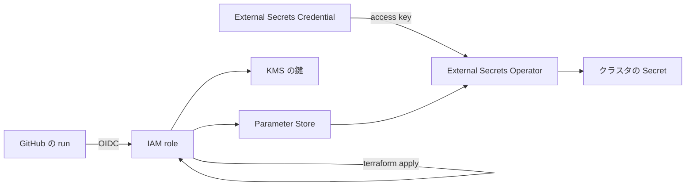

# 資格情報

## 覚えておくこと

- 期限が来るたびに人間が発行し直すものが5つある（下の表）。人間がやるのは値の発行だけで、置き場に入れるのは skill `rotate-credential`。
- CI が使う IAM role は Terraform 自身が作っている。そこを壊す変更を merge すると CI では直せず、手元から直す（skill `recover-ci-role`）。
- KMS の鍵は、消してから 30 日経つと戻らない。それまでなら取り消せる。

ここから下は、資格情報の置き場や信頼の向きを変えるとき、クラスタを作り直すときに読む。

## 人間が発行し直すもの

期限の日付はここに書かない。各コンソールが表示している。

| 値 | 発行する場所 | 置き場 | 要る権限 |
| --- | --- | --- | --- |
| Claude Code のトークン | `claude setup-token`（有効期間は1年） | Parameter Store | — |
| DO の PAT | DO のコントロールパネル | repo secret `DIGITALOCEAN_ACCESS_TOKEN` | `terraform/providers.tf` のコメント |
| Cloudflare の API token | Cloudflare のダッシュボード | repo secret `CLOUDFLARE_API_TOKEN` | `terraform/providers.tf` のコメント |
| HCP Terraform の API token | HCP Terraform | repo secret `TF_API_TOKEN` | — |
| finlake の R2 token | Cloudflare のダッシュボード（R2 → Manage API tokens） | Parameter Store | skill `rotate-credential` |

期限の無いものは、漏れたときと、元を作り直したときだけ入れ替える。GitHub App の鍵（Backstage が repo を読む repo-reader の鍵を含む）、Access のログインに使う OAuth App の Client secret、tunnel token、External Secrets Operator の access key がこれにあたる。手順は同じ skill にある。

## なぜ AWS に置くか

`boykush` は User アカウントなので、organization secret が無い。repo secret に置くと、同じ資格情報を repo の数だけ置き、repo の数だけ入れ替えることになる。だから AWS に1つ置き、各 repo の workflow はその run の OIDC で読む。GitHub 側に長命な秘密は残らない。

ただし run の間は、runner の上に値が載る。repo secret と比べて減るのは「GitHub に長命な秘密が残ること」と「repo の数だけの入れ替え」で、run 中に漏れるリスクは変わらない。Claude Code のトークンを読む action は、AWS の認証情報を job の環境に置かず、role が読めるのも parameter 1本だけに絞ってある。Claude の step は任意のコードを実行するので、そこから先は分けられない。

## 信頼の鎖

壊したときと作り直すときに効く依存：

- CI が使う role は、Terraform 自身が作っている。その role の信頼や権限を壊す変更が merge されると、CI はもう直せない。直すのは手元の `aws login` から（skill `recover-ci-role`）。
- External Secrets Operator は、自分の鍵だけは取れない。クラスタは AWS が検証できない issuer で ServiceAccount token に署名するので、operator は role ではなく access key で読む。その鍵は workflow `external-secrets-credential.yml` が入れる。クラスタを作り直したら、まずこれを1回動かす。ほかの Secret は operator が全部戻す。
- 入る順は Argo CD → External Secrets Operator → 各アプリ。`argocd/` は operator の CRD より先に入るので、そこには Secret を置かない。
- Terraform の state には秘密を載せない。state は HCP にあり、`aws_ssm_parameter` や `aws_iam_access_key` を resource にすると平文で載る。だから値は Terraform を通さず、mise の task が CLI で書く。
- KMS の鍵は、消しても待機期間（30 日）の間は戻せる。`aws_kms_external_key` が `deletion_window_in_days` を指定していないので既定の 30 日で、その間に削除を取り消して有効にし直せばよい。期間が明けると鍵の中身はどこからも読み出せず、App 側で鍵を作り直して入れ直すしかない。素の `terraform destroy` はこの鍵も消す（→ [費用と停止](cost.md)）。

作り直す手順は skill `rebuild-cluster`。
