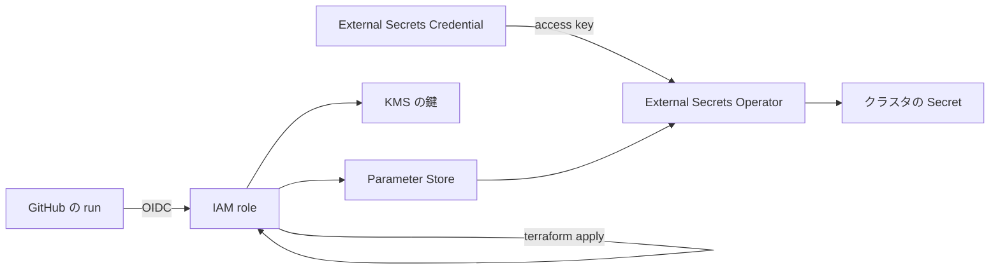

# 資格情報

## 人間が発行し直すもの

エージェントに任せられないのは、GUI やブラウザで値を発行するところだけ。発行した値を置き場に入れる作業は skill `rotate-credential` が行う。

期限が来るたびに発行し直すのは次のもの。期限の日付はここに書かない——各コンソールが表示している。

| 値 | 発行する場所 | 置き場 | 要る権限 |
| --- | --- | --- | --- |
| Claude Code のトークン | `claude setup-token`（有効期間は1年） | Parameter Store | — |
| DO の PAT | DO のコントロールパネル | repo secret `DIGITALOCEAN_ACCESS_TOKEN` | `terraform/providers.tf` のコメント |
| Cloudflare の API token | Cloudflare のダッシュボード | repo secret `CLOUDFLARE_API_TOKEN` | `terraform/providers.tf` のコメント |
| HCP Terraform の API token | HCP Terraform | repo secret `TF_API_TOKEN` | — |
| finlake の R2 token | Cloudflare のダッシュボード（R2 → Manage API tokens） | Parameter Store | `terraform/r2.tf` のコメント |
| TechDocs の R2 token（publish 用・Backstage 用の2つ） | Cloudflare のダッシュボード（R2 → Manage API tokens） | Parameter Store | `terraform/r2.tf` のコメント |

期限の無いもの——GitHub App の鍵、Access のログインに使う OAuth App の Client secret、tunnel token、External Secrets Operator の access key——は、漏れたときと、元を作り直したときだけ入れ替える。手順は同じ skill にある。

## なぜ AWS に置くか

`boykush` は User アカウントなので organization secret が無い。repo secret に置くと、同じ資格情報を repo の数だけ置いて、repo の数だけ入れ替えることになる。AWS に1つ置き、各 repo の workflow はその run の OIDC で読む。GitHub 側に長命な秘密が残らない。

**runner の上には値が載る。** repo secret と比べて消えるのは「GitHub に長命な秘密が残ること」と「入れ替えが repo の数だけ要ること」で、run 中に漏れるリスクは変わらない。Claude Code のトークンを読む action は AWS の認証情報を job の環境に置かず、role が読めるのは parameter 1本だけ、というところまでは絞ってある。Claude の step は任意のコードを実行するので、そこから先は分けられない。

## 信頼の鎖

壊したとき・作り直すときに効くのは、次の依存。

- **CI が使う role は、Terraform 自身が作っている。** その role の信頼や権限を壊す変更が merge されると、CI はもう直せない。直すのは手元の `aws login` から（skill `recover-ci-role`）。
- **External Secrets Operator は、自分の鍵だけは取れない。** クラスタは AWS が検証できない issuer で ServiceAccount token を署名するので、operator は role ではなく access key で読む。その鍵は workflow `external-secrets-credential.yml` が入れる。クラスタを作り直したら、まずこれを1回動かす。他の Secret は operator が全部戻す。
- **入る順は Argo CD → External Secrets Operator → 各アプリ。** `argocd/` は operator の CRD より先に入るので、そこには Secret を置かない。
- **Terraform の state には秘密を載せない。** state は HCP にあり、`aws_ssm_parameter` や `aws_iam_access_key` を resource にすると平文で載る。だから値は Terraform を通らず、mise の task が CLI で書く。
- **KMS の鍵は、消すと戻らない。** 鍵の中身はどこからも読み出せないので、戻すには App 側で鍵を作り直して入れ直すしかない。素の `terraform destroy` はこれも消す（→ [費用と停止](cost.md)）。

作り直す手順は skill `rebuild-cluster`。
